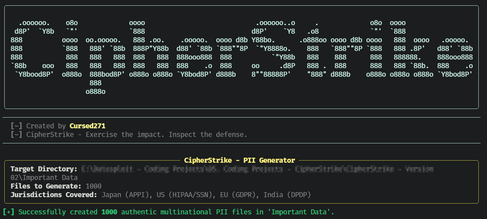
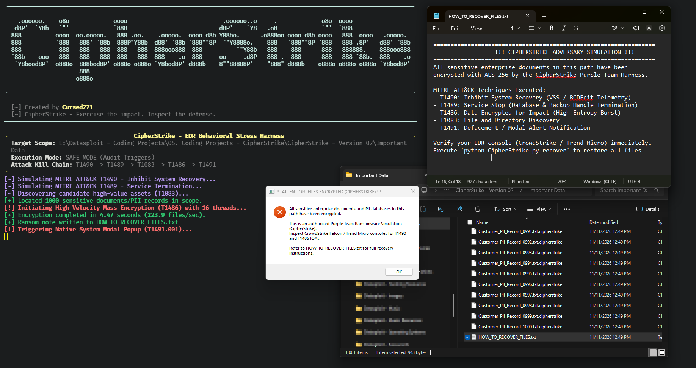
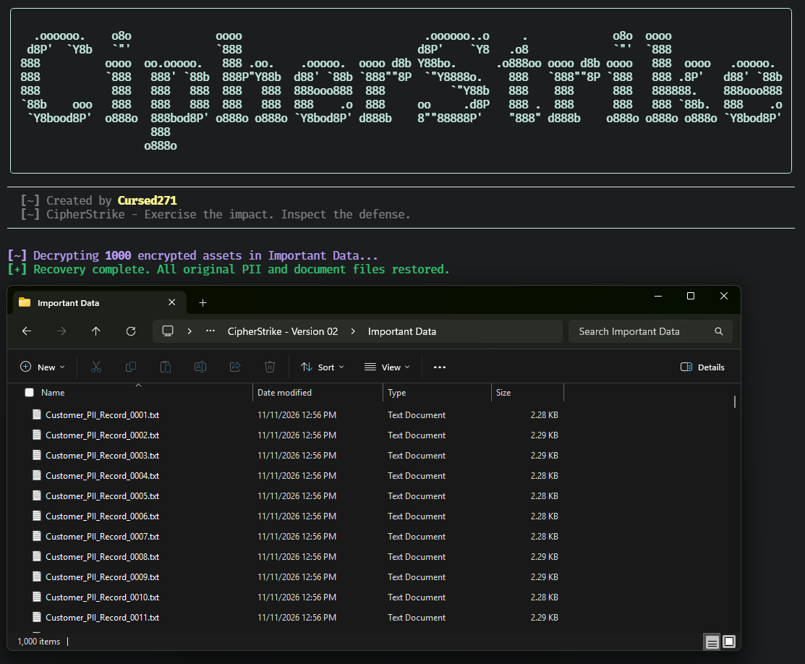

<div align="center">

  

  <h1>CipherStrike</h1>

  <p align="center">
    
  </p>

  <p align="center">
    
    
    
    
    <a href="./LICENSE">
      
    </a>
  </p>

  <p>Exercise the Impact. Inspect the Defense.</p>

</div>


## Overview

CipherStrike is a controlled ransomware-behavior simulation harness for authorized purple-team and detection-engineering exercises.

It generates synthetic multinational PII-style documents, encrypts matching files with AES, emits ransom-note and desktop-notification telemetry, and provides a recovery command for restoring encrypted simulation files.

> CipherStrike is not ransomware. It is an authorized laboratory exercise designed to create observable behavior for defensive validation. Use it only in an isolated, owned, and explicitly authorized environment.

## Features

| Capability | What it does |
| :--- | :--- |
| Synthetic PII generation | Creates fictional employee and customer records spanning Japanese, United States, European Union, and Indian data-protection contexts. |
| File discovery | Finds eligible document, database, image, and archive files within the selected directory. |
| AES encryption | Encrypts discovered files using AES-CFB and a SHA-256-derived key. |
| Ransom-note creation | Writes `HOW_TO_RECOVER_FILES.txt` with exercise and recovery instructions. |
| Desktop notification | Displays a platform-specific modal notification on Windows, macOS, or Linux. |
| Safe-mode triggers | Uses read-only VSS, shadow-copy, service, and boot-configuration commands. |
| Live-mode triggers | Can issue potentially destructive recovery-inhibition and service-stop commands. |
| Recovery workflow | Decrypts `.cipherstrike` files and removes the generated ransom note. |

## Screenshots:

### CipherStrike - PII Generation


### CipherStrike - Encryption


### CipherStrike - Decryption


## Commands

| Command | Purpose |
| :--- | :--- |
| `generate-pii` | Creates synthetic PII-style text files in the selected directory. |
| `simulate` | Runs the controlled encryption and behavioral-trigger exercise. |
| `recover` | Decrypts `.cipherstrike` files and removes the ransom note. |

## ATT&CK Coverage

CipherStrike is intended to generate evidence associated with the following ATT&CK techniques:

| Technique | Name | Simulation behavior |
| :--- | :--- | :--- |
| T1490 | Inhibit System Recovery | Safe mode queries shadow copies and boot configuration; live mode can issue deletion and recovery-disabling commands. |
| T1489 | Service Termination | Safe mode queries selected services; live mode can attempt to stop them. |
| T1083 | File and Directory Discovery | Enumerates eligible files in the target directory. |
| T1486 | Data Encrypted for Impact | Encrypts eligible files with AES-CFB and renames them with `.cipherstrike`. |
| T1491.001 | Defacement: Internal Defacement | Displays a local modal notification. |

> Safe mode is the default and performs audit-style commands rather than destructive actions. Live mode can cause unrecoverable changes and must not be used outside an isolated test system.

## Technology

| Component | Purpose |
| :--- | :--- |
| Python | Application runtime |
| Typer | Command-line interface |
| Rich | Banner, panels, and terminal output |
| cryptography | AES-CFB encryption and decryption |
| concurrent.futures | Concurrent file generation, encryption, and recovery |
| subprocess | Platform-specific command execution |
| ctypes / osascript / zenity / kdialog / notify-send | Desktop notification support |

## Installation

### Prerequisites

- Python 3 with `pip`.
- A writable test directory.
- Appropriate OS permissions for any selected system commands.
- A desktop environment for notification behavior.

Install dependencies:

```bash
python3 -m pip install rich typer cryptography
```

Clone and display help:

```bash
git clone https://github.com/Cursed271/CipherStrike.git
cd CipherStrike
python3 CipherStrike.py --help
```

Use an isolated Python environment. If your environment uses `python` rather than `python3`, substitute that interpreter consistently.

## Usage

### Generate Synthetic Data

```bash
python3 CipherStrike.py generate-pii --dir "Important Data" --count 50 --threads 16
```

This creates `Customer_PII_Record_0001.txt` through `Customer_PII_Record_0050.txt` in the selected directory.

### Run Safe Simulation

```bash
python3 CipherStrike.py simulate --dir "Important Data" --safe-mode
```

Safe mode is the default. It queries recovery and service state, encrypts eligible files, writes the recovery note, and displays a notification.

### Run Recovery

```bash
python3 CipherStrike.py recover --dir "Important Data" --key "CursedSec2026!CipherStrike"
```

Use the exact same `--key` value that was used during `simulate`. Recovery restores original filenames and deletes the `.cipherstrike` files.

## Command-Line Options

### `generate-pii`

| Option | Short | Default | Purpose |
| :--- | :--- | :--- | :--- |
| `--dir` | `-d` | `Important Data` | Directory where synthetic PII files are written |
| `--count` | `-c` | `50` | Number of synthetic files to create |
| `--threads` | `-t` | `16` | File-generation concurrency |

### `simulate`

| Option | Short | Default | Purpose |
| :--- | :--- | :--- | :--- |
| `--dir` | `-d` | `Important Data` | Target directory for the simulation |
| `--key` | `-k` | `CursedSec2026!CipherStrike` | Encryption passphrase |
| `--safe-mode` / `--live-mode` | — | Safe mode | Selects audit-only or potentially destructive trigger behavior |
| `--threads` | `-t` | `16` | Encryption worker count |

### `recover`

| Option | Short | Default | Purpose |
| :--- | :--- | :--- | :--- |
| `--dir` | `-d` | `Important Data` | Directory to restore |
| `--key` | `-k` | `CursedSec2026!CipherStrike` | Decryption passphrase |
| `--threads` | `-t` | `16` | Recovery worker count |

## Eligible Files

The simulation targets files with the following extensions:

`.docx`, `.xlsx`, `.pptx`, `.pdf`, `.txt`, `.csv`, `.sql`, `.db`, `.mdb`, `.jpg`, `.png`, `.zip`, and `.7z`

Files already ending in `.cipherstrike` are excluded from encryption.

## Output & Recovery

The `simulate` command creates:

- `.cipherstrike` encrypted copies of eligible files.
- A `HOW_TO_RECOVER_FILES.txt` ransom-note file.
- A local desktop notification where supported.

The `recover` command restores original files, removes `.cipherstrike` files, and deletes the recovery note.

> The supplied default passphrase is publicly documented in the source. Change it for any exercise where confidentiality of simulated files matters.

## Known Limitations

- The tool uses non-authenticated AES-CFB encryption; it does not provide ciphertext integrity protection.
- File encryption and recovery operations silently suppress many individual file errors.
- The default encryption passphrase is embedded in the source and command-line help.
- Live mode can delete shadow copies, alter boot-recovery configuration, and stop services.
- The tool does not validate EDR alerts automatically; detection validation requires separate telemetry review.
- Desktop notifications depend on the available OS and notification tooling.
- Synthetic PII records resemble sensitive data formats but are generated locally and are not real personal data.

## Safe Use

- Run only in an isolated virtual machine, lab endpoint, or dedicated test directory.
- Obtain explicit authorization before executing any simulation.
- Always begin with `--safe-mode`.
- Never point the tool at production data, shared drives, backup locations, or systems outside the authorized scope.
- Snapshot or back up the test environment before using live mode.
- Use a unique passphrase and retain it securely before starting `simulate`.
- Verify recovery before considering the exercise complete.
- Treat generated files and reports as exercise artifacts, not real PII.

## Troubleshooting

| Problem | What to check |
| :--- | :--- |
| No files encrypted | Target directory, eligible extensions, and prior `generate-pii` execution |
| Recovery fails | Matching `--key`, `.cipherstrike` files, and directory path |
| Notification absent | Desktop session, `zenity`, `kdialog`, `notify-send`, or OS notification support |
| Safe-mode commands fail | Windows administrative context, command availability, and endpoint policy |
| Live-mode risk | Confirm isolation, snapshots, authorization, and rollback capability before proceeding |

## Version History

| Version | Scope |
| :--- | :--- |
| Version 1 | Synthetic PII generation, AES-based encryption exercise, safe/live trigger modes, notification behavior, and recovery workflow |


## License & Usage

CipherStrike is distributed under the CursedSec Ownership Edict (COE).

Read [LICENSE](./LICENSE) for the applicable permissions, restrictions, contribution terms, and disclaimers. Public source availability is not a substitute for those terms.

## Feedback & Contributions

Use the repository's bug-report or feature-request template when issue submission is available.

Include the version, operating system, command, sanitized output, and reproduction steps. Never publish client scan results, credentials, sensitive infrastructure details, or evidence containing confidential data.

Check the security-reporting instructions before disclosing a vulnerability. Review the license and contribution terms before submitting modifications.

## Connect & Collaborate

<div align="center">

  <a href="https://github.com/Cursed271">
    
  </a>
  <a href="https://www.cursedsec.com/">
    
  </a>
  <a href="https://www.linkedin.com/in/cursed271/">
    
  </a>

  <p>Exercise safely. Validate deliberately. Recover completely.</p>
  <sub>CursedSec.com · Cursed271 · CipherStrike</sub>

</div>


